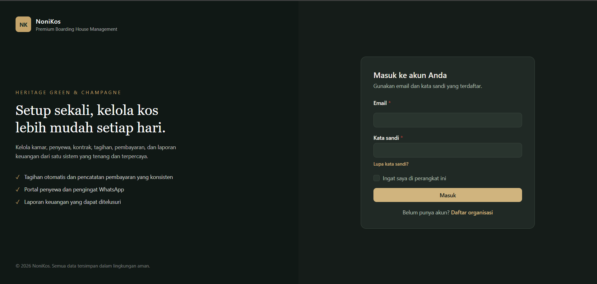
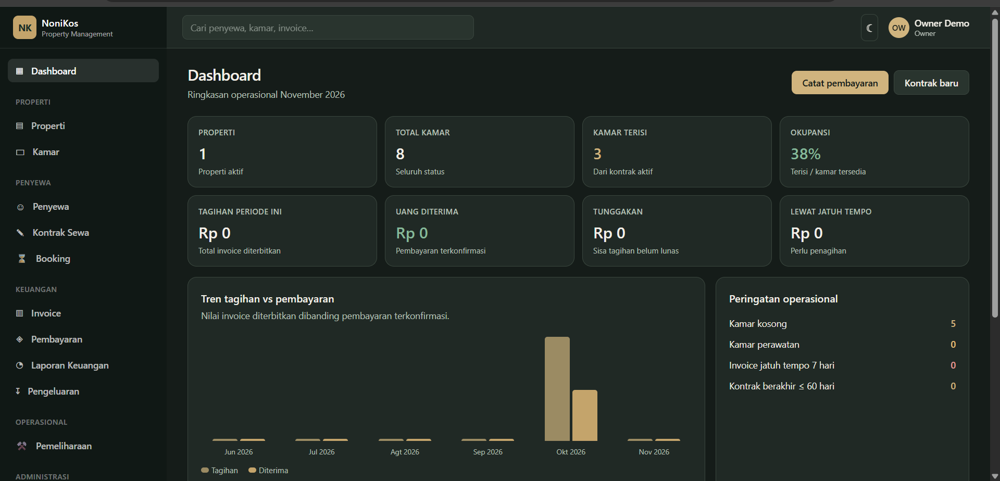
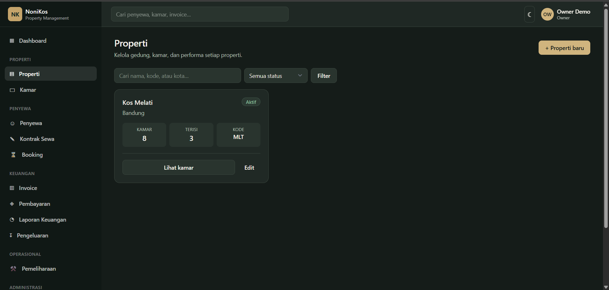
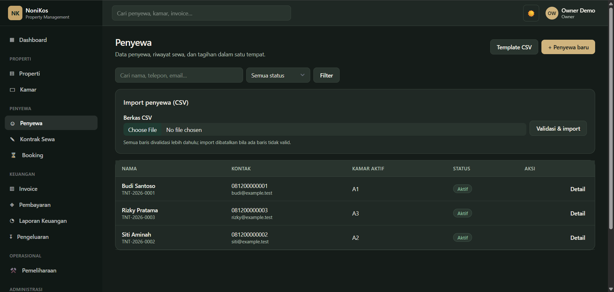
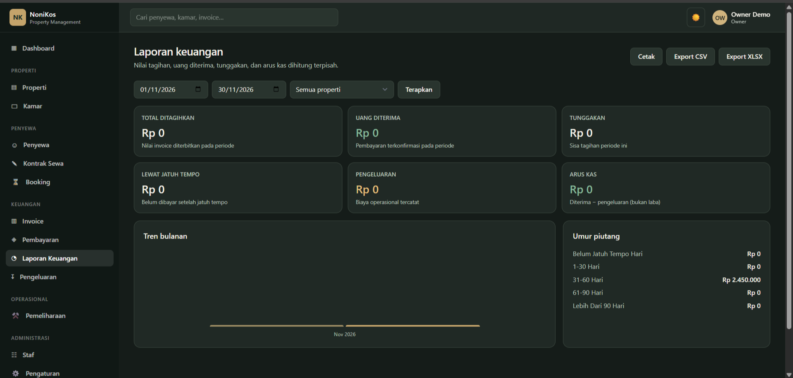
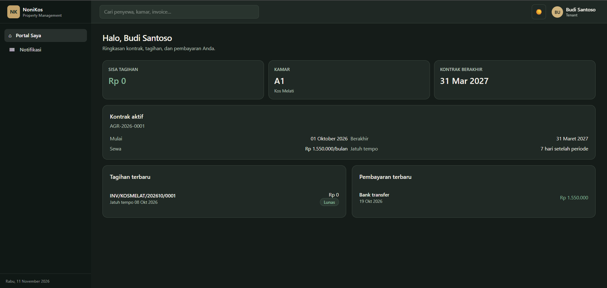

# NoniKos — Sistem Manajemen Kos dan Properti

<p align="center">
  <strong>Kelola Properti. Pantau Hunian. Kendalikan Keuangan.</strong>
</p>

<p align="center">
  Aplikasi manajemen kos berbasis web untuk membantu pemilik properti mengelola operasional, penghuni, penyewaan, tagihan, pembayaran, dan keuangan dalam satu platform terintegrasi.
</p>

<p align="center">
  
  
  
  
  
  
</p>

---

## Tentang NoniKos

Mengelola bisnis kos membutuhkan lebih dari sekadar pencatatan kamar dan penghuni. Pemilik properti juga perlu menangani penyewaan, kontrak, tagihan, pembayaran, pengeluaran, pemeliharaan, hingga aktivitas staf.

**NoniKos** dikembangkan sebagai solusi manajemen properti yang menyatukan kebutuhan tersebut dalam satu aplikasi berbasis web.

Dengan pendekatan **Modular Monolith**, sistem dibangun menggunakan modul-modul berdasarkan fungsi bisnis agar struktur aplikasi lebih terorganisasi, mudah dikembangkan, dan lebih mudah dipelihara.

NoniKos juga menyediakan portal khusus penghuni sehingga informasi penyewaan dan pembayaran dapat diakses secara mandiri.

## Fitur Utama

### 1. Dashboard dan Manajemen Properti
- Ringkasan informasi operasional bisnis kos.
- Pengelolaan beberapa properti dalam satu organisasi.
- Manajemen data dan informasi kamar.
- Pemantauan status serta ketersediaan kamar.
- Informasi kondisi hunian.

### 2. Manajemen Penghuni dan Penyewaan
- Pengelolaan profil dan data penghuni.
- Pencatatan informasi penyewaan.
- Pengelolaan booking dan kontrak.
- Perpanjangan dan pengakhiran kontrak.
- Riwayat penyewaan penghuni.
- Pembuatan dokumen kontrak PDF.

### 3. Tagihan dan Pembayaran
- Pembuatan tagihan sewa.
- Perhitungan tagihan berdasarkan periode penyewaan.
- Dukungan perhitungan prorata dan denda keterlambatan.
- Pemantauan status pembayaran.
- Pencatatan pembayaran manual.
- Riwayat transaksi pembayaran.
- Pembuatan invoice PDF.
- Fondasi integrasi payment gateway melalui konfigurasi aplikasi.

### 4. Manajemen Keuangan
- Pencatatan pemasukan dan pengeluaran.
- Pengelolaan kategori pengeluaran.
- Pemantauan transaksi keuangan.
- Laporan keuangan.
- Ekspor laporan.
- Fitur cetak laporan.

### 5. Portal Penghuni
- Login khusus penghuni.
- Informasi kontrak dan penyewaan.
- Pemeriksaan tagihan.
- Informasi status pembayaran.
- Riwayat pembayaran pribadi.
- Halaman notifikasi penghuni.

### 6. Manajemen Staf dan Hak Akses
- Pengelolaan akun staf.
- Pembagian akses berdasarkan peran.
- Pemisahan hak akses pemilik, manajer, staf keuangan, operasional, dan penghuni.
- Otorisasi untuk membatasi akses terhadap fitur dan data.

### 7. Pemeliharaan dan Operasional
- Pencatatan kebutuhan pemeliharaan properti.
- Pengelolaan permintaan perbaikan.
- Pemantauan aktivitas operasional.

### 8. Notifikasi dan Integrasi WhatsApp
- Pengelolaan template notifikasi.
- Riwayat pengiriman notifikasi.
- Dukungan antrean pengiriman dan retry.
- Fondasi integrasi WhatsApp untuk komunikasi dengan penghuni.

### 9. Activity Log dan Keamanan
- Pencatatan aktivitas penting pengguna.
- Audit aktivitas autentikasi.
- Structured exception logging.
- Pembatasan percobaan login dan permintaan autentikasi.
- Isolasi data antarorganisasi.
- Pembatasan akses berdasarkan peran.

### 10. Backup dan Restore
- Pembuatan database backup.
- Pemeriksaan integritas menggunakan checksum.
- Dukungan proses pemulihan database.
- Pengelolaan akses backup khusus administrator platform.

### 11. Monitoring dan Scheduler
- Endpoint pemeriksaan kesehatan aplikasi (`/health`).
- Pemeriksaan status database dan penyimpanan privat.
- Penjadwalan tugas otomatis melalui Laravel Scheduler.
- Dukungan pemantauan operasional aplikasi.

## Hak Akses Pengguna

NoniKos menggunakan sistem organisasi dengan pembagian hak akses berdasarkan peran.

| Peran | Tanggung Jawab |
|---|---|
| Platform Super Admin | Pengelolaan tingkat platform |
| Owner | Mengelola organisasi dan operasional kos |
| Manager | Mengelola aktivitas manajemen |
| Finance | Mengelola tagihan dan keuangan |
| Operations | Menangani kebutuhan operasional |
| Tenant | Mengakses portal penghuni |

Setiap organisasi memiliki ruang lingkup data tersendiri. Pengguna hanya dapat mengakses informasi sesuai dengan organisasi dan hak akses yang dimilikinya.

## Teknologi

| Komponen | Teknologi |
|---|---|
| Backend | Laravel 10 |
| Bahasa Pemrograman | PHP 8.1+ |
| Database | MySQL / MariaDB |
| Frontend | Blade, HTML, CSS, JavaScript |
| CSS Framework | Tailwind CSS 3 |
| Asset Build | Vite |
| Automated Testing | PHPUnit |
| Arsitektur | Modular Monolith |
| Background Tasks | Laravel Queue |
| Scheduler | Laravel Task Scheduling |

Versi dependensi mengikuti konfigurasi aktual pada repository.

## Hasil Pengujian

Berikut merupakan hasil pengujian dan implementasi yang tercatat selama pengembangan:

| Pengujian | Hasil |
|---|---:|
| Automated Tests | 82 Passed |
| Assertions | 246 |
| Database Migrations | 10 Applied |
| Scheduled Tasks | 8 Registered |
| Frontend Build | Successful |
| HTTP Health Check | Successful |
| Owner Login | Verified |
| Tenant Portal Login | Verified |
| Database Backup | Generated with Checksum |

Hasil tersebut merupakan catatan dari lingkungan pengembangan. Hasil pada lingkungan lain dapat berbeda bergantung pada konfigurasi dan dependensi yang digunakan.


## Pratinjau Aplikasi

Berikut beberapa tampilan antarmuka NoniKos dari sisi administrator dan penghuni.

### 1. Halaman Login


### 2. Dashboard Owner


### 3. Manajemen Properti


### 4. Manajemen Penghuni


### 5. Laporan Keuangan


### 6. Dasbor Penghuni



## Instalasi Lokal

### Persyaratan Sistem

Pastikan perangkat sudah memiliki:

- PHP sesuai persyaratan pada `composer.json` (minimal PHP 8.1).
- Composer.
- MySQL atau MariaDB.
- Node.js dan npm.
- Git.

### 1. Clone Repository

```bash
git clone <URL_REPOSITORY_GITHUB>
cd nonikos
```

### 2. Instal Dependensi

```bash
composer install
npm ci
```

Jika `package-lock.json` tidak tersedia, gunakan `npm install`.

### 3. Konfigurasi Environment

Salin file `.env.example` menjadi `.env`.

Windows PowerShell:

```powershell
Copy-Item .env.example .env
```

Sesuaikan konfigurasi aplikasi dan database pada file `.env`:

```env
APP_NAME=NoniKos
APP_ENV=local
APP_DEBUG=true
APP_URL=http://127.0.0.1:8000
APP_TIMEZONE=Asia/Jakarta
APP_LOCALE=id

DB_CONNECTION=mysql
DB_HOST=127.0.0.1
DB_PORT=3306
DB_DATABASE=nonikos
DB_USERNAME=root
DB_PASSWORD=
```

Buat database bernama `nonikos` terlebih dahulu melalui phpMyAdmin atau MySQL.

Sesuaikan konfigurasi tersebut dengan lingkungan lokal yang digunakan.

### 4. Generate Application Key

```bash
php artisan key:generate
```

### 5. Migrasi dan Data Demo

```bash
php artisan migrate --seed
```

Perintah tersebut menjalankan migrasi database dan membuat data demonstrasi melalui seeder.

> **Penting:** Seeder ditujukan untuk lingkungan pengembangan. Jangan menjalankannya pada database produksi.

### 6. Build Frontend

```bash
npm run build
```

### 7. Jalankan Aplikasi

```bash
php artisan serve
```

Buka aplikasi melalui browser:

**http://127.0.0.1:8000**

## Akun Demo

Setelah database demo berhasil dibuat melalui seeder, akun berikut dapat digunakan untuk mencoba aplikasi.

**URL Login:** `http://127.0.0.1:8000/login`

| Peran | Email | Password |
|---|---|---|
| Owner | `owner@nonikos.test` | `password` |
| Manager | `manager@nonikos.test` | `password` |
| Finance | `finance@nonikos.test` | `password` |
| Operations | `operations@nonikos.test` | `password` |
| Tenant — Budi | `budi@example.test` | `password` |
| Tenant — Siti | `siti@example.test` | `password` |
| Tenant — Rizky | `rizky@example.test` | `password` |

Seluruh akun tersebut merupakan akun sintetis untuk demonstrasi lokal.

> **Keamanan:** Akun demo menggunakan kredensial sederhana dan hanya ditujukan untuk pengembangan. Jangan gunakan akun atau password tersebut pada lingkungan produksi. Seeder menggunakan `firstOrCreate`, sehingga password akun yang sudah pernah dibuat sebelumnya belum tentu otomatis berubah menjadi password demo di atas.

## Menjalankan Automated Tests

Jalankan pengujian menggunakan database testing yang terpisah dari database aplikasi lokal.

```bash
php artisan optimize:clear
php artisan test
```

**Perhatian:**
- Jangan menjalankan automated test menggunakan database produksi.
- Pastikan konfigurasi database testing sudah benar sebelum menjalankan test.
- Ikuti panduan pada `docs/TESTING.md`.
- Pastikan konfigurasi cache tidak bertentangan dengan perlindungan pengujian aplikasi.

## Integrasi Eksternal

Beberapa fitur NoniKos memiliki fondasi integrasi eksternal.

| Integrasi | Status |
|---|---|
| Payment Gateway | Sandbox / Simulasi |
| WhatsApp | Belum aktif tanpa kredensial provider |
| Database Backup | Dapat dijalankan pada lingkungan yang dikonfigurasi |
| Laravel Scheduler | Terdaftar dan membutuhkan proses scheduler aktif |

Untuk mengaktifkan integrasi eksternal, konfigurasi kredensial dan endpoint provider melalui environment aplikasi sesuai dokumentasi teknis.

Contoh variabel konfigurasi:

```env
PAYMENT_GATEWAY_KEY=
PAYMENT_GATEWAY_BASE_URL=
PAYMENT_GATEWAY_WEBHOOK_SECRET=

WHATSAPP_TOKEN=
WHATSAPP_PHONE_NUMBER_ID=
```

Jangan menyimpan API key atau kredensial rahasia secara langsung di source code atau repository publik.

## Scheduler dan Queue

Beberapa proses aplikasi menggunakan Laravel Scheduler dan Queue.

Untuk menjalankan scheduler pada lingkungan pengembangan:

```bash
php artisan schedule:work
```

Untuk menjalankan queue worker:

```bash
php artisan queue:work
```

Pada lingkungan produksi, scheduler dan queue worker perlu dikonfigurasi sebagai proses terpisah sesuai infrastruktur server.

## Struktur Dokumentasi

Dokumentasi teknis tambahan tersedia pada folder `docs/`.

| File | Keterangan |
|---|---|
| `docs/PRODUCT_REQUIREMENTS.md` | Kebutuhan produk |
| `docs/ARCHITECTURE.md` | Arsitektur aplikasi |
| `docs/ERD.md` | Entity Relationship Diagram |
| `docs/BUSINESS_RULES.md` | Aturan bisnis |
| `docs/PERMISSIONS.md` | Hak akses pengguna |
| `docs/DESIGN_SYSTEM.md` | Panduan desain antarmuka |
| `docs/ROADMAP.md` | Roadmap pengembangan |
| `docs/IMPLEMENTATION_STATUS.md` | Status implementasi |
| `docs/SECURITY.md` | Dokumentasi keamanan |
| `docs/TESTING.md` | Panduan pengujian |
| `docs/BACKUP_RESTORE.md` | Panduan backup dan restore |
| `docs/DEPLOYMENT.md` | Panduan deployment |
| `docs/CHANGELOG.md` | Riwayat perubahan |

## Keamanan dan Batasan

NoniKos dikembangkan dengan memperhatikan beberapa aspek keamanan:

- Authentication dan authorization berbasis peran.
- Pembatasan akses data berdasarkan organisasi.
- Validasi dan pembatasan permintaan autentikasi.
- Audit trail untuk aktivitas penting.
- Perlindungan terhadap formula injection pada ekspor data.
- Pengelolaan konfigurasi rahasia melalui environment.
- Pembatasan akses terhadap file backup.

Beberapa hal yang belum termasuk dalam implementasi saat ini:

- Subscription billing dan enforcement paket SaaS.
- Two-Factor Authentication (2FA).
- Automated browser end-to-end testing.
- Off-site backup otomatis.
- Integrasi payment gateway dan WhatsApp secara live tanpa kredensial provider.

Pemulihan backup ke lingkungan produksi juga harus melalui prosedur verifikasi dan pengujian terlebih dahulu.

## Pengembangan Selanjutnya

NoniKos dirancang agar dapat terus dikembangkan sesuai kebutuhan operasional dan bisnis.

Beberapa area pengembangan lanjutan meliputi:

- Integrasi payment gateway secara live.
- Aktivasi WhatsApp Business API.
- Penguatan keamanan autentikasi.
- Automated end-to-end testing.
- Pengembangan sistem langganan SaaS.
- Peningkatan monitoring dan infrastruktur deployment.

## Lisensi

Belum ada lisensi open-source yang ditetapkan untuk proyek ini.

Hak penggunaan, modifikasi, dan distribusi mengikuti ketentuan pemilik repository.

---

<p align="center">
  <strong>NoniKos</strong><br>
  Kelola Kos Lebih Teratur, Bisnis Lebih Terkendali.
</p>